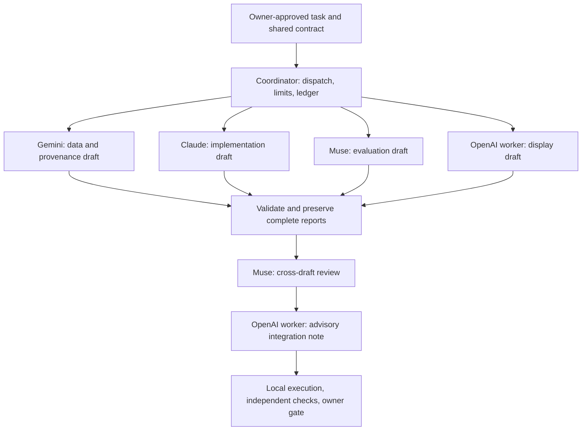

# Cyrus Strategic Prediction Model

## A multi-model orchestration research project — paused for redesign, not abandoned

**Architect, operator, and owner:** Rob Legorreta · Cyrus Forge Systems, LLC  
**Documentation date:** October 28, 2026  
**Status:** Production development paused by the owner. The replacement approach has not been released or authorized for execution.  
**Repository scope:** A public, sanitized design record and engineering retrospective. This documentation package is not a runnable application, a source-code release, or evidence of production readiness.

I started this project to explore a practical question: can several AI models, connected through controlled API pipelines, contribute specialized work to one auditable prediction and decision-support system?

The goal was more than getting multiple models to answer the same question. I wanted distinct responsibilities, explicit handoffs, independent review, reproducible testing, and a readable private output. The system was intended to keep probabilistic forecasts, external reference data, uncertainty, and decision rules separate so an operator could understand both the result and the evidence behind it.

The early connection tests worked. The harder challenge was turning successful API responses into consistent, executable, independently reviewed deliverables. That gap is the central lesson of this project.

## Why this record exists

People following my work asked me to document the journey, including the parts that did not go according to plan. This repository records the intended architecture, the work that was actually observed, the operational struggles, and why I chose to pause.

**This project is not dead.** I am keeping its underlying emphasis on disciplined decisions, uncertainty, and accountable evidence. I plan to release a different approach to API orchestration and model collaboration after my other two projects are officially tested and completed. There is no announced restart date, replacement implementation, or promise that every original model will retain the same role.

## The intended outcome

- Produce probabilistic forecasts with explicit uncertainty and documented assumptions.
- Track where inputs came from and when they were available.
- Route bounded work to different models through a coordinator.
- Pass complete artifacts between drafting, review, and integration stages.
- Test generated code in an actual execution environment before accepting it.
- Present an understandable private overview rather than exposing an internal task tracker as the final experience.
- Keep human approval, spending controls, and acceptance decisions outside model-generated status narratives.

These were goals, not a claim that the finished system existed.

## How the models communicated

The models did not share an invisible conversation, persistent common memory, or direct access to one another's applications. A Python coordinator assembled requests, called provider APIs, validated responses, and supplied the returned reports to the next stage.

In a recorded early handoff on October 19, 2026, Gemini received Muse's actual reply, and Claude received both preceding replies. That demonstrated bounded cross-provider message passing. The later drafting workflow ran four initial assignments in parallel, followed by a review and an advisory integration stage.

This diagram describes the historical workflow, not a currently running service. Muse's own evaluation work still needed a different reviewer. OpenAI's integration note could not independently accept its own display work.

## Who was assigned what

| Participant | Initial responsibility | Important boundary / later change |
|---|---|---|
| Rob Legorreta | Architecture, operation, scope, budget, priorities, final decisions | Retained authority to pause, change scope, and approve phase advancement |
| ChatGPT/Codex | Coordination, shared contracts, integration, local testing, dashboard work, documentation | Separate from the OpenAI API worker; later took over implementation work that had been assigned to Claude |
| Gemini | Source coverage, typed data definitions, provenance, timestamp risks | Later removed from the critical path when authenticated transport was unavailable in the execution runtime; executable fallback assigned to an OpenAI worker |
| Claude | Provisional Python implementation, validation, baseline drafts, test drafts | Later restricted to bounded review input; the critical implementation path moved to ChatGPT/Codex |
| Muse | Evaluation protocol, quantitative review, acceptance fixtures, cross-draft review | Could not accept its own protocol; a later missed dispatch cutoff triggered split cross-review |
| OpenAI API worker | Display/schema drafts, checklists, advisory integration | Not this conversation and not automatically a code executor; later records also use “OpenAI worker” for local execution/review, which must not be mistaken for an external API call |

Assignments did not prove activity. A task needed a real executor, job identity, start time, artifact, and validation evidence before it could be described as executed.

## What was demonstrated

The retained checkpoint records these historical milestones:

- Individual provider connection/generation checks and a bounded three-provider handoff.
- A complete six-report drafting/review/integration workflow after recovery, with earlier valid drafts reused.
- Local execution of returned code and additional tests that revealed defects missed by the original supplied tests.
- Coordinator controls for complete-report validation, cached recovery, bounded calls, planning reservations, and preserved failure records.
- Local provenance, evidence-reconciliation, delivery-chronology, and integration packages with recorded review.
- A later local integration checkpoint reporting **209 of 209 regression tests passing** for its bounded scope.
- A narrowly scoped manual owner acceptance after automated acceptance controls failed additional trust-boundary review.

These are historical records, not tests rerun for this documentation. The 209-test result is not a forecast-quality measure, evidence of cloud deployment, or certification of later gate-control work. Subsequent acceptance-control defects remained unresolved automatically.

## What did not become reliable

Successful authentication did not establish that a model could consistently produce a complete, valid artifact. A valid report did not prove its code was correct. Passing local tests did not prove deployment or owner-visible delivery. Agreement between two AI reviewers did not establish correctness.

The external drafting calls initially had no repository, browser, source-fetch, or execution tools. Asking a model to act as an implementer did not give it the capability to run its code. Some operational work therefore remained with the coordinator and local execution environment.

The workflow also accumulated repair and acceptance-control work while the owner was still missing the consistent end result described in the plan. More status reporting was not a substitute for that result.

## My experience as the architect and operator

At times, it felt like managing a team with different personalities. A model would respond successfully during an initial test, then later return an incomplete or unusable result. From the operator's side, that could feel like someone no longer doing their assigned job.

That is a description of my experience, **not a technical conclusion about motivation**. The records do not establish that Claude refused to work for ChatGPT, that Gemini followed its example, or that the models were choosing not to cooperate. They show distinguishable failures: output truncation, response-contract rejection, a temporary service error, a local parser defect, missing execution transport, substantive code defects, and insufficient evidence for acceptance.

It would also be inaccurate to say Claude never delivered anything. Claude returned code; 23 supplied tests passed locally before additional probes found defects. A later diagnostic returned a corrected schema-valid draft. OpenAI and Muse also had issues, including a report-size rejection and review errors. The responsible account is about the complete workflow, not blaming one provider.

See [the retrospective](docs/RETROSPECTIVE.md) for the incident-by-incident distinction.

## Why I paused

I paused because work was not being completed consistently according to the plan, the orchestration required too much intervention, and the resulting experience was not matching what we had laid out. Reassigning roles helped produce bounded local artifacts, but it did not establish the dependable end-to-end system I intended.

The pause is an architectural and operational decision. It is not proof that multi-model collaboration cannot work, nor a claim that the existing work has no value. The next approach will need to earn confidence through smaller, measurable end-to-end demonstrations.

The older control records still contain a phase-review state and historical targets. The owner's later stop instruction governs current production work. Preparing this documentation does not restart that work or authorize the next phase.

## Documentation map

| File | Purpose |
|---|---|
| [Technical specification](docs/TECHNICAL_SPECIFICATION.md) | Historical setup, contracts, lifecycle boundaries, safety controls, and requirements to consider for the unreleased redesign |
| [Retrospective](docs/RETROSPECTIVE.md) | Timeline, failure classes, corrections to the personality interpretation, and lessons |
| [Evidence and publication notes](docs/EVIDENCE_AND_PUBLICATION.md) | Source limits, historical test scope, privacy boundaries, and release checklist |

## Cost and responsible handling

The approved initial combined allowance was **$100**, with no renewal or reset: $5 allocated for cloud planning and $95 for AI/other APIs. A local reservation or estimated model cost was never equivalent to a provider invoice or an account-wide spending cap. This package does not claim a reconciled final project cost.

This public record omits credentials, account identifiers, private file links, deployment addresses, raw operational datasets, and unredacted logs. It makes no claim that employer or client data was used. No performance or financial-return claim is being made.

## Availability and rights

This package documents the project; it does not provide runtime installation instructions or a production endpoint. The operational source, tests, private records, and datasets are not included. No open-source license is granted by this documentation package; a license decision is separate from preparing it for GitHub.

**Next milestone:** a documented replacement plan, released after my other two projects are tested and completed, followed by an explicitly authorized bounded pilot.
